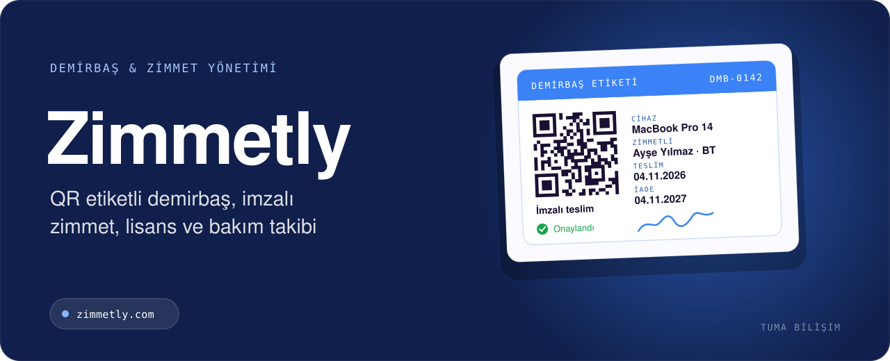

  

    

<h3 align="center">Şirketinizdeki tüm bilgisayar, telefon, lisans ve ekipmanı tek panelden yönetin. QR ile zimmet verin, imzayla teslim alın, lisans ve bakım tarihlerini kaçırmayın.</h3>

 

## 🎯 Kimler için?

- İK, BT ve idari işler ekipleri
- Demirbaşını Excel'den kurtarmak isteyen KOBİ'ler
- Çok şubeli ve kurumsal yapılar

## ✨ Öne çıkan özellikler

- QR etiketli demirbaş takibi; telefondan okutarak zimmet, iade ve sayım
- İmzalı zimmet, devir ve iade süreçleri; beklenen iade tarihi ve departman ataması
- Yazılım lisansı ve sözleşme takibi; koltuk sayısı, bitiş tarihi ve yenileme hatırlatmaları
- Periyodik bakım planları ve otomatik iş emirleri
- Ortak kullanılan ekipman için rezervasyon ve ödünç verme
- Office 365 entegrasyonu, sarf malzeme stoku, fatura ve garanti belgeleri
- E-posta ve Telegram bildirimleri, self-servis arıza bildirim portalı
- Telefona kurulabilen mobil web uygulaması (PWA)

## 🧱 Teknoloji

`PHP` `MySQL` `JavaScript` `PWA` `Microsoft 365`

## 📬 Demo, kurulum ve fiyat

Zimmetly için canlı demo, kurulum ve fiyat bilgisi almak isterseniz:

- 🌐 **Teklif formu:** [tumabilisim.com/iletisim](https://tumabilisim.com/iletisim?urun=Zimmetly)
- 💬 **WhatsApp:** [+90 533 432 15 12](https://wa.me/905334321512?text=Merhaba%2C%20Zimmetly%20hakk%C4%B1nda%20bilgi%20almak%20istiyorum.)
- ✉️ **E-posta:** [info@tumabilisim.com](mailto:info@tumabilisim.com?subject=Zimmetly%20hakk%C4%B1nda)

İşletmenize özel uyarlama ve entegrasyon da yapıyoruz.

---

<b>🇬🇧 English</b>

 

**Zimmetly** — Multi-tenant asset & assignment management SaaS: QR-tagged assets, signed check-out/return, license and contract tracking, maintenance work orders, bookings and Microsoft 365 integration.

Live product: https://zimmetly.com/tanitim.php · Contact: [info@tumabilisim.com](mailto:info@tumabilisim.com) · WhatsApp: [+90 533 432 15 12](https://wa.me/905334321512)

---

Bu depo ürün tanıtımı içindir. Ürün ticari bir yazılım olduğundan kaynak kodu paylaşılmamaktadır. Kurulum, demo ve fiyat bilgisi için iletişime geçin. 
Tasarım & Geliştirme: <a href="https://tumabilisim.com">Tuma Bilişim</a> · <a href="https://github.com/gkhnfyz">@gkhnfyz</a>
